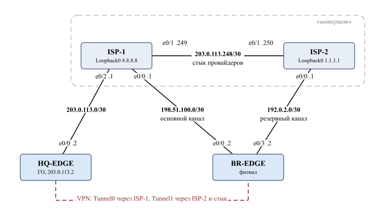

# ЛР1 БКС — шпаргалка к защите

Здесь: как устроена сеть и как её рассказать, что происходит при отказах, частые вопросы и словарь всех
терминов из отчёта. Схема стенда — `img/topology.png` (рисунок 1 отчёта): слева филиал, справа головной офис (ГО).

---

## 1. Схема за две минуты

**Что спроектировано.** Сеть предприятия из двух площадок: филиал (блок адресов 10.2.0.0/16) и головной
офис (10.1.0.0/16). Обе площадки построены по трёхуровневой модели «доступ — распределение — ядро» и связаны
через интернет защищённым туннелем (VPN). Интернет эмулируют два маршрутизатора провайдеров: ISP-1 (адрес 8.8.8.8)
и ISP-2 (1.1.1.1).

**Как рассказывать схему — снизу вверх:**

1. **Доступ** (ASW-1…3, HQ-ASW-1/2) — сюда подключены компьютеры, серверы и камеры. Здесь узлы делятся по VLAN
   и защищаются порты: Port Security, DHCP Snooping, DAI. Каждый коммутатор доступа подключён к **обоим**
   коммутаторам распределения: один аплинк работает, второй заблокирован MSTP и ждёт отказа первого.
2. **Распределение** (DSW-1/2, HQ-DSW-1/2) — пара коммутаторов L3. Это шлюзы по умолчанию для всех VLAN:
   виртуальный адрес .1 держит один из пары (HSRP в филиале, VRRP в ГО), второй в резерве. Здесь же фильтрация
   между VLAN (ACL) и пересылка DHCP-запросов на сервер (DHCP relay).
3. **Ядро** (BR-CORE и BR-CORE-2, HQ-CORE-1/2) — два коммутатора, которые только быстро передают пакеты по OSPF.
   На ядре нет ACL и NAT. Маршрут по умолчанию идёт через оба ядра одновременно (ECMP).
4. **Граница** (BR-EDGE, HQ-EDGE) — выход в интернет с трансляцией адресов (NAT) и VPN-шлюз между площадками.

**Филиал, чем особенный:**
- два провайдера: основной ISP-1 и резервный ISP-2. Переключение автоматическое: IP SLA пингует ISP-1, при пропаже
  ответов основной маршрут снимается;
- вариант 5: отдел продаж (VLAN 40) может обращаться в VLAN разработки (20) **только** к файловому серверу 10.2.20.42.

**ГО, чем особенный:**
- публичный адрес 203.0.113.2, через него ходят в интернет все внутренние сети (NAT);
- **DMZ** (VLAN 100, 10.1.100.0/28 + IPv6 fd00:1:100::/64) — веб-сервер и почтовый сервер, опубликованные в интернет
  (порты 80/443 → SRV-WEB, 25 → SRV-MAIL). Из DMZ во внутренние сети ходить нельзя (ACL `DMZ-IN`);
- **межсетевые экраны** pfSense HQ-FW-1 и HQ-FW-2 стоят в разрыве «граница — ядро» (каждый на пути к своему ядру),
  а HQ-FW-2 ещё и в разрыве «граница — DMZ». Сейчас они **прозрачные**: работают как L2-мост, ничего не фильтруют
  и в traceroute не видны. Правила на них — следующие лабы;
- сервер HQ-INFRA (10.1.55.10): DHCP, DNS (зона `hq.local`) и NTP для обеих площадок;
- отличия от филиала: VRRP вместо HSRP, L3 EtherChannel между ядрами, аплинки доступа по 2 линка в LACP.

**Связь площадок:** два туннеля GRE, зашифрованных IPsec, между BR-EDGE и HQ-EDGE. Tunnel0 идёт через ISP-1
(основной, стоимость OSPF 10), Tunnel1 — через ISP-2 (резервный, стоимость 100). Поверх туннелей работает OSPF,
поэтому площадки сами узнают сети друг друга. Через туннель администраторы ГО заходят по SSH на коммутаторы филиала.

## 2. Как устроен «интернет»: ISP-1 и ISP-2

**Коротко для защиты:** «Два маршрутизатора ISP-1 и ISP-2 вместе моделируют интернет. Каждый — сеть отдельного
провайдера, линк между ними — межпровайдерский стык. Подключение обеих площадок к ISP-1 — упрощение прототипа:
для VPN важно только, чтобы публичные адреса площадок были доступны друг другу через интернет».

**Кто к кому подключён:**

Исходник картинки — `img/isp-scheme.typ`, пересборка: `typst compile img/isp-scheme.typ img/isp-scheme.svg`.

| Линк | Подсеть | Смысл |
|---|---|---|
| ISP-1 e0/0 — BR-EDGE e0/0 | 198.51.100.0/30 | основной канал филиала |
| ISP-2 e0/0 — BR-EDGE e0/3 | 192.0.2.0/30 | резервный канал филиала |
| ISP-1 e0/2 — HQ-EDGE e0/0 | 203.0.113.0/30 | единственный канал ГО, публичный адрес ГО — 203.0.113.2 |
| ISP-1 e0/1 — ISP-2 e0/1 | 203.0.113.248/30 | стык провайдеров («магистраль интернета») |

**Что такое 8.8.8.8 и 1.1.1.1.** Это адреса на интерфейсах Loopback0 провайдеров, «сайты в интернете», до которых
пингуем. Адреса взяты похожими на настоящие публичные DNS Google и Cloudflare, чтобы было наглядно. На стенде это просто
адреса роутеров ISP. Все остальные внешние адреса — из диапазонов для документации (RFC 5737: 192.0.2.0/24,
198.51.100.0/24, 203.0.113.0/24). Они не принадлежат реальным сетям, их и полагается использовать в учебных примерах.

**Как провайдеры маршрутизируют.** В реальном интернете провайдеры обмениваются маршрутами по BGP, на стенде вместо
этого статические маршруты через стык: каждый ISP знает свои сети, а к сетям соседа ходит через него. Про сети
10.x.x.x провайдеры **ничего не знают** — частные адреса в интернете не маршрутизируются. Поэтому пакет из сети
предприятия возвращается обратно, только если граница заменила его адрес на публичный (NAT).

**Как моделируется «доступ в интернет».** Настоящего внешнего мира в стенде нет. «Интернет» — это два адреса:
8.8.8.8 на ISP-1 и 1.1.1.1 на ISP-2. Узел «имеет интернет», если с него проходит `ping 8.8.8.8` и при этом
на граничном маршрутизаторе появляется трансляция NAT (`show ip nat translations`).
- **Путь пакета:** узел → свой шлюз (DSW) → маршрут по умолчанию, который EDGE раздаёт по OSPF
  (`default-information originate`) → EDGE меняет частный адрес на публичный (NAT) → ISP-1 → Loopback0 отвечает
  на публичный адрес → EDGE по таблице трансляций возвращает ответ узлу.
- **«Интернет запрещён»** (камеры CAM1 и CAM-HQ): ACL на SVI отбрасывает пакет, VPCS показывает
  `Communication administratively prohibited` от шлюза, трансляций NAT нет.
- **Обращение «из интернета»** к опубликованному серверу: с ISP-1 `telnet 203.0.113.2 80` — на HQ-EDGE появляется
  трансляция 203.0.113.2:80 → 10.1.100.10:80. Соединение не устанавливается (VPCS не веб-сервер), но публикация работает.

**Как граница выбирает провайдера:**
- **HQ-EDGE** — один маршрут по умолчанию на 203.0.113.1 (ISP-1), выбора нет;
- **BR-EDGE** — два маршрута по умолчанию: основной через ISP-1, привязанный к `track 1`, и резервный («плавающий»)
  через ISP-2 с административным расстоянием 10 — он в таблице не виден, пока жив основной. IP SLA каждые 5 с пингует
  шлюз ISP-1; нет ответов → track Down → основной маршрут снимается → работает резервный. NAT меняет адреса
  на адрес того провайдера, через которого уходит трафик (198.51.100.2 или 192.0.2.2).

**Зачем IP SLA, если есть маршрут по умолчанию?** Статический маршрут снимается сам только при падении интерфейса.
Частая реальная авария — интерфейс в up, но провайдер дальше не пропускает трафик (сломалось у него внутри).
Поэтому в тесте отказа выключали интерфейс **на стороне ISP-1**: у BR-EDGE e0/0 оставался up, и спасал только IP SLA.

**Как через провайдеров идут туннели:**

| Туннель | Откуда → куда | Путь пакетов |
|---|---|---|
| Tunnel0 (основной) | BR-EDGE 198.51.100.2 → HQ-EDGE 203.0.113.2 | BR-EDGE → ISP-1 → HQ-EDGE (внутри одного провайдера) |
| Tunnel1 (резервный) | BR-EDGE 192.0.2.2 → HQ-EDGE 203.0.113.2 | BR-EDGE → ISP-2 → **стык** → ISP-1 → HQ-EDGE |

Провайдеры видят только зашифрованные пакеты между публичными адресами, сети 10.x внутри туннеля им не видны.

**Зачем стык:** ГО подключён только к ISP-1, без линка ISP-1 — ISP-2 резервный туннель (он начинается в сети ISP-2)
не дошёл бы до ГО. **Почему оба EDGE на ISP-1:** упрощение; VPN строится поверх интернета и от провайдера не зависит.
Ограничение: при отказе ISP-1 ГО теряет интернет и оба туннеля — это есть в таблице единичных точек отказа.

**Что показать на защите:**
- `show ip nat translations` на BR-EDGE во время пинга 8.8.8.8 с PC-ADMIN — внутренний адрес ↔ 198.51.100.2;
- `show track brief` и `show ip route 0.0.0.0` на BR-EDGE до и после `shutdown` e0/0 на ISP-1;
- `show crypto isakmp sa` на HQ-EDGE — два пира: 198.51.100.2 (Tunnel0) и 192.0.2.2 (Tunnel1).

## 3. Адресация (запомнить логику, а не цифры)

- Второй октет — площадка: **10.1.x.x — ГО, 10.2.x.x — филиал.** Третий октет = номер VLAN (10.2.**20**.0 — VLAN 20).
- В каждой пользовательской подсети: **.1 — виртуальный шлюз** (HSRP/VRRP), **.2 — DSW-1**, **.3 — DSW-2**.
- Маски разные (VLSM): подсеть подобрана по числу узлов с запасом — /24 для 254 узлов, /26 для 62, /27 для 30, /28 для 14.
- Каналы между маршрутизаторами — /30 (2 адреса) из 10.x.255.0/24; router-id OSPF — из 10.x.254.0/24.
- Туннели: 172.16.0.0/30 (Tunnel0) и 172.16.0.4/30 (Tunnel1).
- Внешние адреса взяты из документационных диапазонов: 198.51.100.0/30 (филиал–ISP-1), 192.0.2.0/30 (филиал–ISP-2),
  203.0.113.0/30 (ГО–ISP-1).

| VLAN | Филиал (10.2.x) | ГО (10.1.x) |
|---|---|---|
| 10 | ADMIN — администраторы | ADMIN |
| 20 | DEV — разработка (файловый сервер .42) | STAFF — сотрудники |
| 30 | ACC — бухгалтерия | — |
| 40 | SALES — продажи | — |
| 50 | SERVERS — DHCP-сервер 10.2.50.10 | SERVERS — SRV-INT |
| 55 | — | INFRA — HQ-INFRA (DHCP, DNS, NTP) |
| 60 | GUEST — гости, только интернет | GUEST |
| 70 | CCTV — камеры, без интернета | CCTV |
| 99 | MGMT — управление коммутаторами | MGMT |
| 100 | — | DMZ (на HQ-EDGE) |
| 999 | BLACKHOLE — native VLAN транков и неиспользуемые порты | то же |

Балансировка: в филиале DSW-1 — активный шлюз и корень MSTP для VLAN 10, 30, 50, 70 (экземпляр MST1), DSW-2 — для
20, 40, 60, 99 (MST2). В ГО так же: HQ-DSW-1 — VLAN 10, 50, 55; HQ-DSW-2 — 20, 60, 70, 99. Активный шлюз и корень STP
специально совпадают: трафик не делает лишний крюк через соседний DSW.

## 4. Как идёт пакет (готовые примеры для объяснения)

**PC-ADMIN (10.2.10.10) → интернет 8.8.8.8:**
ASW-1 → аплинк к DSW-1 (корень MST1, активный HSRP для VLAN 10) → DSW-1 смотрит маршрут по умолчанию, у него два
равноценных пути (BR-CORE и BR-CORE-2) → ядро → BR-EDGE → NAT меняет 10.2.10.10 на 198.51.100.2 → ISP-1.

**PC-SALES → файловый сервер 10.2.20.42 (вариант 5):**
ASW-2 → DSW (шлюз VLAN 40) → на входе SVI Vlan40 стоит ACL `SALES-IN`: строка «разрешить до host 10.2.20.42»
срабатывает → пакет уходит в VLAN 20. Тот же пакет к PC-DEV1 упадёт на строке «запретить 10.2.40.0/26 → 10.2.20.0/24».
Обратное направление закрывает `DEV-IN` на Vlan20: из VLAN 20 в продажи может только сам файловый сервер.

**PC-HQ-STAFF → PC-ADMIN филиала (через VPN):**
HQ-ASW-1 → HQ-DSW → HQ-CORE → (прозрачный HQ-FW, его не видно) → HQ-EDGE → маршрут к 10.2.0.0/16 выучен по OSPF через
Tunnel0 → пакет заворачивается в GRE, шифруется IPsec и идёт через ISP-1 → BR-EDGE расшифровывает → ядро филиала →
DSW → ASW → PC-ADMIN. NAT такой трафик не трогает: правило «10.0.0.0/8 → 10.0.0.0/8» исключено из трансляции.

**Интернет → веб-сервер:** клиент обращается к 203.0.113.2:80 → HQ-EDGE по статической трансляции портов (static NAT)
отправляет его на 10.1.100.10:80 → через мост HQ-FW-2 → HQ-DMZ → SRV-WEB.

## 5. Что будет, если… (отказоустойчивость)

| Отказ | Что происходит | Как проверяли |
|---|---|---|
| ISP-1 (основной провайдер филиала) | IP SLA перестаёт получать ответы → `track 1` Down → основной статический маршрут снимается, работает плавающий через ISP-2 (AD 10) → NAT в адрес 192.0.2.2. Резервный туннель Tunnel1 держит связь с ГО | `show track brief`, `show ip route 0.0.0.0`, `show ip nat translations` |
| Коммутатор ядра BR-CORE | Через dead-интервал OSPF (40 с) DSW теряют соседа, маршрут по умолчанию остаётся один — через BR-CORE-2 | `show ip ospf neighbor`, пинг с DSW-1 без потерь |
| Аплинк коммутатора доступа | MSTP переводит заблокированный аплинк (Alternate) в Forwarding за секунды благодаря `link-type point-to-point` | `show spanning-tree mst 1` до/во время отказа, ping шлюза |
| Коммутатор распределения | Второй DSW становится активным шлюзом (HSRP/VRRP), MSTP перестраивается | — (логика протоколов) |
| HQ-FW-1 | HQ-EDGE теряет соседа HQ-CORE-1, весь трафик идёт через HQ-FW-2 и HQ-CORE-2 | `show ip ospf neighbor` на HQ-EDGE, интернет и филиал из ГО есть |
| HQ-FW-2 | Пропадает DMZ: единственный путь к ней идёт через HQ-FW-2 | — (единичная точка отказа, в таблице отчёта) |

Единичные точки отказа, которые сознательно оставлены: граничные маршрутизаторы (по одному на площадке),
единственный провайдер ГО, HQ-FW-2 для DMZ, серверы DHCP/DNS, сам коммутатор доступа (у ПК один сетевой порт).

## 6. Безопасность: что от чего защищает

| Механизм | Где | От чего защищает |
|---|---|---|
| VLAN | везде | разные отделы в разных широковещательных доменах, между ними только через шлюз и ACL |
| ACL на SVI | DSW, HQ-DSW | гости — только в интернет; камеры — только к серверам; сеть управления — только для админов; вариант 5 |
| Port Security (`restrict`) | ASW | подключение чужих устройств и подмена MAC: не больше 2 MAC на порт пользователя (ПК + IP-телефон), 1 — на порт сервера и камеры |
| DHCP Snooping | ASW | поддельный DHCP-сервер в сети: DHCP-ответы принимаются только с аплинков (trusted). Заодно строит таблицу IP–MAC–порт–VLAN |
| DAI | ASW | ARP-спуфинг (атака «человек посередине»): ARP сверяется с таблицей Snooping. Серверы со статическими адресами разрешены списком `DAI-STATIC` |
| Неиспользуемые порты → VLAN 999 + shutdown | ASW | подключение к свободной розетке |
| Native VLAN 999, `switchport nonegotiate` | транки | VLAN hopping (двойная метка, подделка DTP) |
| BPDU Guard + PortFast | порты узлов | подключение постороннего коммутатора, атаки на STP |
| SSH v2 + `access-class VTY-MGMT` | все коммутаторы филиала | управление только по шифрованному каналу и только из сетей администраторов |
| `DMZ-IN` | HQ-EDGE | взломанный сервер DMZ не может открыть соединение во внутреннюю сеть |
| IPsec | туннели | трафик между площадками зашифрован и защищён от подмены |

**Привязка IP–MAC–порт** («IP–MAC binding» из задания) обеспечена связкой DHCP Snooping (таблица привязок) + DAI
(проверка ARP по ней) + Port Security (лимит MAC на порт). Проверка на защите: на PC-GUEST вручную задать чужой IP —
DAI отбрасывает его ARP, пинг не идёт.

## 7. Особенности эмулятора (если спросят «почему так»)

- **`no ip cef` на коммутаторах распределения.** В образе IOL L2 аппаратная (CEF) коммутация теряла транзитные пакеты
  между VLAN одного коммутатора. После отключения CEF пакеты обрабатывает процессор, и всё работает. На реальном
  оборудовании это не нужно. В отчёте — раздел «Траблшутинг».
- **IP Source Guard не используется.** В эмуляторе блокирует узлы с адресами по DHCP даже при правильной таблице.
  Подобранное оборудование (Catalyst 9200) его поддерживает.
- **`spanning-tree link-type point-to-point`.** IOL считает свои порты полудуплексными, поэтому быстрое согласование
  RSTP не работало и переключение занимало ~30 с. Явный тип канала включает быстрый режим.
- **`ip route 0.0.0.0 0.0.0.0 <шлюз>` вместо `ip default-gateway` на ASW.** Образ коммутатора по умолчанию
  маршрутизирует, а в этом режиме `ip default-gateway` игнорируется.
- **DHCP Snooping в ГО по VLAN разнесён между HQ-ASW** (HQ-ASW-1 — 10, 20, 60; HQ-ASW-2 — 50, 55, 70). Каждый
  коммутатор проверяет только VLAN своих узлов. Если один VLAN проверяли оба коммутатора, в эмуляторе DHCP-пакеты
  ходили по кругу мимо блокировки STP. На защиту это не влияет: узлы каждого VLAN подключены только к одному HQ-ASW.

## 8. Вероятные вопросы

- **Зачем три уровня?** Разделение функций и масштабирование: доступ подключает узлы, распределение маршрутизирует
  и фильтрует, ядро только быстро передаёт. Отказ или расширение одного уровня не ломает другие.
- **Почему HSRP в филиале и VRRP в ГО?** Чтобы показать оба. HSRP — протокол Cisco, VRRP — открытый стандарт
  (RFC 5798), позволяет ставить оборудование разных производителей. Работают одинаково: виртуальный IP .1,
  активный выбирается приоритетом (110) с вытеснением (preempt).
- **Зачем два экземпляра MSTP?** Чтобы в нормальном режиме работали оба аплинка: половина VLAN идёт через DSW-1,
  половина через DSW-2. С одним деревом второй аплинк просто простаивал бы.
- **Почему на ядре нет ACL и NAT?** Ядро должно передавать трафик максимально быстро; фильтрация — на распределении,
  NAT — на границе.
- **Что такое ECMP на DSW?** У маршрута по умолчанию два равноценных next-hop (оба ядра), трафик делится между ними,
  при отказе одного остаётся второй.
- **Зачем GRE, если есть IPsec?** IPsec сам по себе не передаёт multicast, а OSPF работает на multicast. GRE даёт
  обычный интерфейс-туннель, по нему ходит OSPF, а IPsec его шифрует.
- **Как выбирается туннель?** Стоимостью OSPF: Tunnel0 — 10, Tunnel1 — 100. Пока основной жив, резервный не используется.
- **Почему DMZ на границе, а не в ядре?** Публичные серверы — самые атакуемые. Их держат на отдельном сегменте
  у границы, чтобы при взломе они не оказались внутри сети.
- **Зачем межсетевые экраны, если они ничего не фильтруют?** По заданию в ЛР1 экран нужно интегрировать в топологию,
  а политики разрабатываются в следующих работах. Прозрачный режим позволил встроить его, не меняя адресацию.
- **Почему IPv6 только в DMZ?** Так в задании (Dual-Stack в DMZ). Использован ULA-префикс fd00:1:100::/64
  (частные адреса IPv6), серверы получают адрес сами по SLAAC из объявлений маршрутизатора.
- **Почему ГО и филиал подключены к одному провайдеру и зачем линк между ISP?** ISP-1 и ISP-2 вместе — модель
  интернета, линк между ними — межпровайдерский стык. VPN строится поверх интернета, ему нужна только связность
  публичных адресов. Подробно — раздел 2.
- **Почему у провайдеров нет маршрутов в 10.x?** Частные адреса в интернете не маршрутизируются. Наружу выходят
  только адреса после NAT, а трафик между площадками идёт внутри зашифрованного туннеля.
- **Почему ISP вместо настоящего интернета?** Ответ по сути: «Интернет смоделирован двумя маршрутизаторами провайдеров.
  Для задач лабы важна не связь с реальными сайтами, а то, что происходит на границе сети: NAT, переключение на резервного
  провайдера, VPN между площадками, публикация серверов из DMZ. Всё это на модели проверяется полностью, и даже лучше,
  чем на настоящем интернете». Если начнут уточнять, почему лучше:
  1. **Два провайдера и управляемые отказы.** У филиала два провайдера, отказ основного имитировался выключением
     интерфейса на стороне ISP-1. С реальным интернетом второго провайдера взять неоткуда, а «уронить» чужого нельзя.
  2. **Нужен «внешний клиент».** Публикацию веб-сервера проверяли обращением к публичному адресу ГО с ISP-1.
     Из реального интернета до 203.0.113.2 за NAT VMware никто не достучится.
  3. **Публичные адреса.** Настоящих публичных IP у площадок нет. Взяты диапазоны для документации (RFC 5737), так
     принято в учебных и проектных примерах. VPN построен на этих адресах, и модель интернета их маршрутизирует.
  4. **Воспроизводимость.** Стенд не зависит от сети, где запущен: выгрузку можно поднять на любом компьютере, и
     результаты будут те же.
  5. **Так устроен и реальный интернет:** сети отдельных провайдеров, связанные стыками. Мы повторили это —
     два провайдера и межпровайдерский канал, только маршруты заданы статикой вместо BGP.

  Если спросят «а можно подключить настоящий»: «Можно: подключить ISP-1 к облаку PNETLab с выходом через NAT хоста
  и включить на ISP-1 ещё одну трансляцию адресов. Схема внутри предприятия при этом не меняется».
- **Почему в ГО каналы продублированы, а в филиале нет?** Канал между DSW удвоен на обеих площадках. Разница — между
  ядрами (в ГО L3 EtherChannel из 2 линков, в филиале 1 линк) и на аплинках доступа (в ГО по 2 линка к каждому DSW,
  в филиале по 1). Причины:
  1. **Так в задании:** для ГО методичка требует «отказоустойчивую иерархическую модель»; распределение агрегирует
     каналы доступа «для увеличения пропускной способности и отказоустойчивости».
  2. **ГО — центр сети:** VPN-шлюз, DNS и NTP для обеих площадок, управление филиалом, DMZ. Сбой в ГО задевает всех,
     поэтому лишние порты там оправданы.
  3. **Что даёт второй линк:** обрыв кабеля не меняет топологию — агрегат остаётся up, STP и OSPF не перестраиваются,
     теряется только половина ёмкости.
  4. **Филиалу хватает одного линка:** по расчёту самый нагруженный ASW-1 даёт 3,6 Гбит/с при аплинке 10 Гбит/с,
     а отказоустойчивость уже есть — два аплинка к двум DSW, два ядра, HSRP. Удвоение было бы переплатой.

  Если дожимают: «Филиал можно сделать так же — это вопрос стоимости. Филиал спроектирован по минимально
  достаточному расчёту, ГО — с запасом как критичный узел».
- **Зачем L3 EtherChannel между ядрами и почему на нём IP?** Кратко: ядро работает на L3, поэтому канал между ядрами —
  маршрутизируемый, как все каналы ядра; адрес задан на логическом Port-channel, потому что для маршрутизатора два
  линка — это один интерфейс. Подробно — раздел 9.
- **Как филиал получает время и DNS?** NTP-сервер HQ-INFRA в ГО, филиал ходит к нему через VPN. Ответы NTP
  коммутаторам доступа разрешены отдельной строкой в ACL сети управления.

## 9. Подробнее: L3 EtherChannel между ядрами ГО

Ядра HQ-CORE-1 и HQ-CORE-2 соединены двумя линками, которые LACP объединяет в один логический интерфейс Port-channel1.
IP-адрес (10.1.255.25 и .26/30) задан на Port-channel1, а не на портах: ядро работает на L3, все его каналы —
маршрутизируемые /30 с OSPF, и для маршрутизатора два линка — это один интерфейс. В отличие от L2-агрегата между
HQ-DSW (транк с VLAN и STP), здесь нет ни VLAN, ни STP. При обрыве одного линка канал остаётся up, соседство OSPF
не рвётся, падает только пропускная способность. На стенде это проверяется командой `show etherchannel summary`:
`Po1(RU)`, где R — routed.

---

## 10. Словарь терминов

### Модель сети и проектирование

- **КВС** — корпоративная вычислительная сеть.
- **Трёхуровневая (иерархическая) модель** — деление сети на уровни доступа, распределения и ядра (модель Cisco).
- **Уровень доступа (Access)** — коммутаторы, к которым подключаются конечные устройства.
- **Уровень распределения (Distribution)** — коммутаторы L3, маршрутизация между VLAN, фильтрация, резервирование шлюза.
- **Уровень ядра (Core)** — высокоскоростная магистраль между блоками распределения и границей.
- **Граница (Edge)** — маршрутизатор подключения к провайдеру: NAT, VPN.
- **ГО** — головной офис.
- **Прототип** — уменьшенная модель сети в эмуляторе для проверки решений (меньше узлов, те же функции).
- **Единичная точка отказа (SPOF)** — элемент без резерва, отказ которого прерывает сервис.
- **Пропускная способность аплинка** — сколько трафика должен выдержать канал вверх от коммутатора. В отчёте считалась
  по формуле: число портов × коэффициент одновременной активности × скорость на порт × (1 + резерв 30 %).
- **Неблокирующая коммутационная матрица** — внутренняя производительность коммутатора не меньше суммы скоростей всех
  портов в обе стороны (8 портов × 10 Гбит/с × 2 = 160 Гбит/с).

### Оборудование и физика

- **L2 / L3** — канальный уровень (кадры, MAC-адреса, коммутация) / сетевой уровень (пакеты, IP, маршрутизация).
- **Многоуровневый коммутатор (L3-коммутатор)** — коммутатор, который ещё и маршрутизирует (через SVI).
- **SFP+** — разъём под модуль 10 Гбит/с (оптика или медь).
- **PoE / PoE+** — питание устройств по витой паре. 802.3af (PoE) — до 15,4 Вт на порт, 802.3at (PoE+) — до 30 Вт.
- **Cisco Catalyst 9200L / 9500, ISR 4331/4451** — подобранные модели: доступ / распределение и ядро / граница.
- **Точка доступа Wi-Fi 6 (802.11ax)** — беспроводной доступ, питается по PoE+.
- **Видеорегистратор (NVR)** — сервер записи камер; камерам разрешён доступ только к серверному сегменту.

### Эмулятор

- **PNETLab** — эмулятор сетей (форк EVE-NG): узлы — виртуальные машины и процессы, соединённые виртуальными линками.
- **IOL (IOS on Linux)** — образ Cisco IOS, запущенный как процесс Linux. L3 — маршрутизатор, L2 — коммутатор.
- **VPCS** — простейший виртуальный ПК: IP, ping, traceroute, DHCP. Используется как ПК, серверы и камеры.
- **pfSense** — межсетевой экран на FreeBSD (свободное ПО).

### VLAN и коммутация

- **VLAN** — виртуальная локальная сеть: логическое деление коммутатора на изолированные широковещательные домены.
- **Access-порт** — порт одного VLAN (к узлу). **Trunk** — порт, по которому идут кадры многих VLAN с метками.
- **802.1Q (dot1q)** — стандарт меток VLAN в кадре.
- **Native VLAN** — VLAN, кадры которого идут по транку без метки. Вынесен в неиспользуемый 999 против VLAN hopping.
- **VLAN hopping** — атака, при которой узел попадает в чужой VLAN (двойная метка или подделка транка).
- **DTP** — протокол Cisco для автосогласования транка; выключен `switchport nonegotiate`.
- **VTP** — протокол Cisco для рассылки списка VLAN. Режим `transparent` — коммутатор не принимает чужие изменения.
- **VLAN 999 (BLACKHOLE)** — «мёртвый» VLAN для неиспользуемых портов и native VLAN.
- **SVI (interface VlanN)** — виртуальный L3-интерфейс коммутатора в VLAN; его адрес — шлюз для узлов VLAN.
- **ARP** — протокол, который по IP узнаёт MAC в локальной сети.
- **Широковещательный домен** — область, куда доходит широковещательный кадр (= один VLAN).

### STP / MSTP

- **STP (Spanning Tree Protocol)** — протокол, который блокирует лишние линки, чтобы в L2-сети не было петель.
- **RSTP (802.1w)** — быстрый STP: переключение за секунды через обмен proposal/agreement.
- **MSTP (802.1s)** — несколько деревьев STP (экземпляров), к каждому привязана группа VLAN. Позволяет балансировать
  нагрузку по аплинкам.
- **Экземпляр (instance) MST0 / CIST** — общее дерево для всего региона. **MST1, MST2** — наши экземпляры.
- **Корневой мост (root)** — центр дерева, выбирается по наименьшему приоритету (4096 у корня).
- **Root port / Designated / Alternate (Blocking)** — порт к корню / порт, передающий в сегмент / резервный
  заблокированный порт.
- **link-type point-to-point** — пометка порта как полнодуплексного канала «точка-точка», нужна для быстрого RSTP.
- **PortFast (`portfast edge`)** — порт к конечному узлу сразу переходит в Forwarding, без ожидания STP.
- **BPDU / BPDU Guard** — служебный кадр STP / защита, выключающая порт узла, если на нём появился BPDU (чужой коммутатор).

### Агрегирование каналов

- **EtherChannel / Port-channel (Po)** — несколько физических линков, объединённых в один логический (больше
  пропускная способность, отказ линка не рвёт канал).
- **LACP (802.3ad)** — стандартный протокол согласования агрегата. `mode active` — сторона сама предлагает LACP.
- **L3 EtherChannel** — агрегат с IP-адресом (маршрутизируемый), как между HQ-CORE-1 и HQ-CORE-2.
- **Состояния в `show etherchannel summary`**: `SU` — L2-агрегат работает, `RU` — L3-агрегат работает, `P` — порт в агрегате.

### Маршрутизация

- **Маршрутизация между VLAN** — передача пакетов из одной подсети в другую через шлюз (SVI на DSW).
- **Статический маршрут** — заданный вручную. **Маршрут по умолчанию (0.0.0.0/0)** — «всё, чего не знаю, — туда».
- **Плавающий статический маршрут** — резервный маршрут с большим административным расстоянием (у нас 10).
  Попадает в таблицу, только когда пропадает основной.
- **Административное расстояние (AD)** — степень доверия к источнику маршрута: меньше — лучше.
- **OSPF** — протокол динамической маршрутизации по состоянию каналов: роутеры обмениваются топологией и сами
  считают кратчайшие пути.
- **Area 0 (backbone)** — основная область OSPF; у нас одна область на всю сеть.
- **Router-ID** — уникальный идентификатор маршрутизатора в OSPF (вида 10.2.254.2).
- **Сосед / состояние FULL** — маршрутизаторы установили соседство и полностью синхронизировали базы.
- **DR/BDR** — выделенный и резервный маршрутизаторы в сегменте с несколькими соседями.
- **Hello / Dead-интервал** — 10 с / 40 с; если за dead-интервал нет hello, сосед считается упавшим.
- **Стоимость (cost)** — метрика OSPF; путь с меньшей суммарной стоимостью лучше.
- **passive-interface** — интерфейс участвует в OSPF своей сетью, но соседей через него не ищет (порты к пользователям).
- **`default-information originate`** — граничный роутер раздаёт маршрут по умолчанию по OSPF.
- **ECMP** — несколько равноценных путей к одной сети, трафик делится между ними.
- **BGP** — протокол обмена маршрутами между провайдерами (автономными системами) в интернете; на стенде заменён статикой.

### Резервирование шлюза

- **HSRP** (Cisco) — два роутера держат общий виртуальный IP .1; активный отвечает, резервный ждёт.
  `standby N priority 110` — приоритет, `preempt` — вернуть роль после восстановления.
- **VRRP** (RFC 5798) — открытый аналог HSRP; роли Master / Backup.
- **Виртуальный IP (VIP)** — адрес шлюза, который «переезжает» между устройствами пары.

### NAT

- **NAT** — подмена адресов на границе: частные адреса 10.x.x.x меняются на публичный.
- **PAT / NAT overload** — много внутренних адресов за одним внешним, различаются по портам.
- **Static NAT / проброс порта** — постоянное соответствие «внешний адрес:порт → внутренний сервер:порт»
  (публикация SRV-WEB).
- **inside / outside** — внутренние и внешние интерфейсы NAT.
- **Таблица трансляций** (`show ip nat translations`) — текущие соответствия inside local ↔ inside global.

### Отслеживание доступности

- **IP SLA** — зонд, который периодически шлёт ICMP (каждые 5 с к шлюзу ISP-1) и следит за ответами.
- **Track** — объект отслеживания, Up/Down по результату зонда; к нему привязан основной статический маршрут.

### VPN

- **VPN (Site-to-Site)** — защищённый канал между двумя площадками через интернет.
- **GRE** — туннель: исходный пакет целиком вкладывается в новый IP-пакет. Передаёт multicast, поэтому по нему работает OSPF.
- **IPsec** — набор протоколов шифрования и проверки целостности IP-трафика.
- **IKE (фаза 1)** — шлюзы проверяют друг друга по общему ключу (PSK) и договариваются о ключах. `QM_IDLE` в
  `show crypto isakmp sa` — канал установлен.
- **ESP (фаза 2)** — шифрование самих данных (AES-256). Счётчики `encaps/decaps` — сколько пакетов зашифровано и расшифровано.
- **Транспортный режим** — шифруется только содержимое GRE-пакета, без лишнего заголовка.

### Фильтрация (ACL)

- **ACL** — список правил «разрешить/запретить», проверяется сверху вниз до первого совпадения. В конце неявный «запретить всё».
- **Стандартный ACL** — фильтр только по адресу источника (`VTY-MGMT`). **Расширенный** — по источнику, назначению,
  протоколу и порту.
- **in / out** — правило применяется к пакетам, входящим в интерфейс / выходящим из него.
- **Wildcard-маска** — инвертированная маска (0.0.0.63 = /26).
- **`established`** — пропускать только ответы на уже открытые TCP-соединения.
- **RFC 1918** — частные диапазоны 10/8, 172.16/12, 192.168/16; гостям они закрыты.

### Безопасность доступа

- **Port Security** — ограничение числа MAC-адресов на порту. `violation restrict` — лишние кадры отбрасываются со
  счётчиком нарушений, порт не выключается. **Sticky** — запоминание MAC в конфиг (в проекте не используется).
- **DHCP Snooping** — коммутатор пропускает DHCP-ответы только с доверенных (trusted) портов и строит таблицу привязок.
- **Таблица привязок (binding)** — IP–MAC–порт–VLAN для каждого клиента DHCP.
- **DAI (Dynamic ARP Inspection)** — проверка ARP-пакетов по таблице привязок; отсекает ARP-спуфинг.
- **ARP ACL (`arp access-list DAI-STATIC`)** — разрешение для узлов со статическими адресами, которых нет в таблице Snooping.
- **ARP-спуфинг (ARP poisoning)** — атака, при которой злоумышленник выдаёт себя за шлюз и перехватывает трафик.
- **IP Source Guard (IPSG)** — фильтрация IP-трафика с порта по таблице привязок (в прототипе не используется).
- **Rogue DHCP** — посторонний DHCP-сервер, раздающий неправильные шлюз и DNS.

### Сервисы

- **DHCP** — автоматическая выдача IP, шлюза и DNS. **Пул** — диапазон адресов для подсети; **excluded-address** —
  адреса, которые не раздавать (.1–.9 — шлюзы и оборудование).
- **DHCP relay (`ip helper-address`)** — шлюз VLAN пересылает широковещательный DHCP-запрос на сервер в другой подсети.
- **DNS** — перевод имён в адреса. Зона `hq.local`, записи `ip host`.
- **NTP** — синхронизация времени. **Stratum** — «расстояние» от эталона; `ntp master 3` — сервер считает себя
  источником уровня 3, клиенты получают уровень 4. Точное время нужно для журналов и сертификатов.
- **SSH v2** — шифрованный удалённый доступ к консоли; ключ RSA 2048 бит, локальная учётная запись `netadmin`.

### DMZ и межсетевые экраны

- **DMZ** — демилитаризованная зона: отдельный сегмент для серверов, доступных из интернета.
- **Межсетевой экран (МЭ, firewall)** — устройство фильтрации трафика между зонами.
- **Прозрачный режим / L2-мост (bridge)** — МЭ соединяет два интерфейса как коммутатор, без своих IP в пути трафика.
  Его не видно в traceroute, адресация сети не меняется.
- **IPS** — система предотвращения вторжений: анализирует трафик и блокирует атаки по сигнатурам.
- **WAF** — межсетевой экран прикладного уровня для веб-приложений (SQL-инъекции, XSS).
- **CARP** — протокол кластера pfSense (аналог VRRP) — решение для резервирования МЭ.

### IPv6

- **Dual-Stack** — одновременно IPv4 и IPv6 на одном интерфейсе.
- **ULA (fd00::/8)** — уникальные локальные адреса IPv6, аналог частных 10.x.
- **SLAAC** — узел сам строит адрес: префикс из объявления маршрутизатора + идентификатор из MAC (EUI-64).
- **RA (Router Advertisement)** — объявление маршрутизатора с префиксом сети и адресом шлюза.
- **ICMPv6 / NDP** — служебный протокол IPv6; в нём работают ping6, RA и поиск соседей (замена ARP).

### Пересылка пакетов (к разделу «Траблшутинг»)

- **CEF** — быстрая (аппаратная) пересылка по заранее построенным таблицам.
- **Process switching** — медленная пересылка процессором; при `no ip cef` используется она.

### Диагностика

- **ping / traceroute** — проверка доступности / список маршрутизаторов на пути. `source Vlan10` — отправить
  с адреса конкретного интерфейса.
- **`show ip ospf neighbor`, `show ip route`, `show ipv6 route`** — соседи и таблицы маршрутизации.
- **`show spanning-tree mst N`** — роли и состояния портов в экземпляре MSTP.
- **`show standby brief` / `show vrrp brief`** — состояние HSRP / VRRP.
- **`show crypto isakmp sa`, `show crypto ipsec sa`** — состояние туннелей IPsec.
- **`show ip nat translations`**, **`show ip access-lists`** (счётчики matches), **`show ip dhcp snooping binding`**,
  **`show etherchannel summary`**, **`show track brief`**.

---

Полный сценарий проверок на сдаче с командами — `demo-checks.md`. Проект ГО с портами — `hq-plan.md`.
